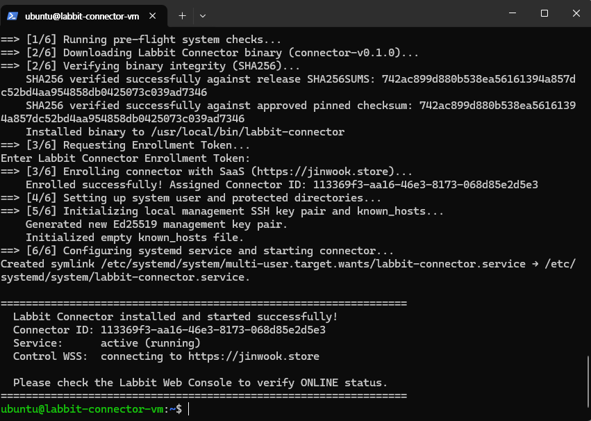
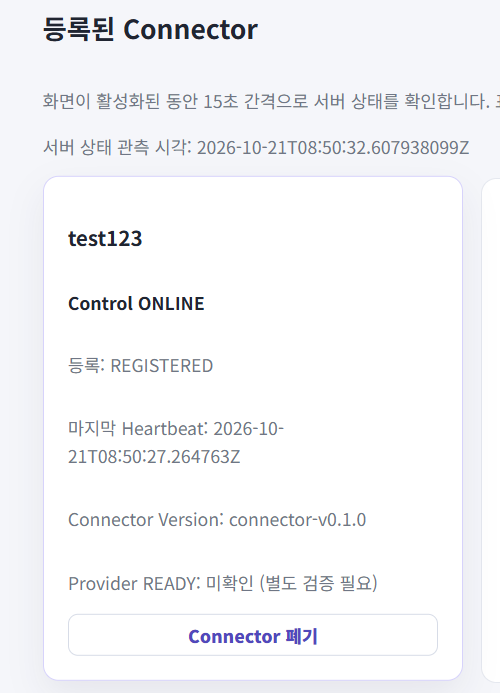

# LBT-61 · Connector Customer Installation & Enrollment MVP 실환경 검증 증적

- **실행일**: 2026-10-21 KST
- **대상 티켓**: [LBT-61](https://samsunglions.atlassian.net/browse/LBT-61) (`[CC-04] Connector Customer Installation & Enrollment MVP`)
- **담당자(DRI)**: 이주희
- **연계 서브태스크**:
  - [LBT-181](https://samsunglions.atlassian.net/browse/LBT-181): `[CC-04-1] Connector Runtime Hardening · Binary Release · Installer` (완료)
  - [LBT-182](https://samsunglions.atlassian.net/browse/LBT-182): `[CC-04-2] SaaS Enrollment API · Credential · Connector 상태` (완료)
  - [LBT-183](https://samsunglions.atlassian.net/browse/LBT-183): `[CC-04-3] Connector 관리자 UX · Installer 설치 안내` (완료)

> **증적의 범위(2026-10-23 문서 정합성 검토)**: 2026-10-21 검증 담당자가 기록한 명령·로그 발췌와 PR에 첨부된 PNG 2개를 구분합니다. 본 보완에서는 PNG와 저장소의 Installer 코드를 대조했으며, 당시 VM·SaaS에 재접속하거나 Smoke를 재실행하지 않았습니다. 첨부 화면만으로 직접 확인되지 않는 결과는 제출자 기록 또는 `not verified`로 명시합니다.

---

## 1. 검증 환경 및 대상

| 구분 | 정보 | 비고 |
| :--- | :--- | :--- |
| **대상 호스트** | KT Cloud D1 `labbit-connector-vm` (공인 IP: `211.184.227.97`) | 신규 생성된 실제 클라우드 Linux VM |
| **운영체제** | Ubuntu 24.04 LTS (Noble Numbat, Kernel `6.8.0-142-generic`) | 개발도구(Go) 미설치 순수 환경 |
| **바이너리 버전** | `connector-v0.1.0` (commit `e0caea4f3191e9109171c02581d498f48e4c9887`) | GitHub Releases 공식 배포 바이너리 |
| **승인 고정 SHA256** | `742ac899d880b538ea56161394a857dc52bd4aa954858db0425073c039ad7346` | 인스톨러 스크립트 내 암호화 앵커 핀 |
| **연동 SaaS 주소** | `https://jinwook.store` | 운영 SaaS API / WSS / Web Console |
| **등록된 Connector** | ID: `113369f3-aa16-46e3-8173-068d85e2d5e3` / 표시 이름: `test123` | 단회성 Enrollment Token 정상 소비 완료 |

---

## 2. 실환경 검증 절차 및 실측 기록

### 1) 사전 준비 및 클린 환경 확인
VM 내부에서 Go 개발 환경이 존재하지 않는 순수 고객사 환경임을 확인했습니다:
```bash
$ which go || echo 'No Go installed'
No Go installed
$ cat /etc/os-release
NAME="Ubuntu"
VERSION="24.04 LTS (Noble Numbat)"
ID=ubuntu
```

### 2) 공식 인스톨러 원라이너 실행 및 릴리즈 무결성 이중 검증
웹 콘솔(`/connectors`)에서 발급받은 일회용 Enrollment Token을 기반으로 공식 인스톨러를 실행했습니다:
```bash
curl -fsSL https://raw.githubusercontent.com/ktcloud4-SL/labbit-app/main/scripts/installer/install.sh | \
  sudo LABBIT_SAAS_BASE_URL="https://jinwook.store" sh
```

**URL 출처:** 위 `main` URL은 검증 담당자가 실제 사용했다고 남긴 명령을 그대로 보존한 것입니다(변경 가능한 브랜치 참조). 웹 배포 Workflow의 승인 Installer는 [commit `c91d5a4` 고정 URL](https://raw.githubusercontent.com/ktcloud4-SL/labbit-app/c91d5a4aa7a3ddfcccc1360830092829c22e569f/scripts/installer/install.sh)을 사용합니다. 2026-10-23 GitHub 조회 시 `main`, 해당 commit 및 이 PR HEAD의 `install.sh` Git Blob SHA는 모두 `c2f1d08804883b9076a02716f661f70ba73e89fb`로 같았습니다. 이는 **현재 저장소 내용 비교**이며 2026-10-21 당시 HTTP 응답 자체를 별도 보관·해시 검증했다는 뜻은 아닙니다. 재현 시에는 변경 불가능한 commit URL을 우선합니다.

첨부된 [`installer-execution.png`](./installer-execution.png)에서 읽을 수 있는 핵심 출력 발췌(화면 줄바꿈만 정리, 생략 부분은 `...` 표기):
```text
==> [1/6] Running pre-flight system checks...
==> [2/6] Downloading Labbit Connector binary (connector-v0.1.0)...
==> [2/6] Verifying binary integrity (SHA256)...
    SHA256 verified successfully against release SHA256SUMS: 742ac899d880b538ea56161394a857dc52bd4aa954858db0425073c039ad7346
    SHA256 verified successfully against approved pinned checksum: 742ac899d880b538ea56161394a857dc52bd4aa954858db0425073c039ad7346
    Installed binary to /usr/local/bin/labbit-connector
==> [3/6] Requesting Enrollment Token...
Enter Labbit Connector Enrollment Token:
==> [3/6] Enrolling connector with SaaS (https://jinwook.store)...
    Enrolled successfully! Assigned Connector ID: 113369f3-aa16-46e3-8173-068d85e2d5e3
==> [4/6] Setting up system user and protected directories...
==> [5/6] Initializing local management SSH key pair and known_hosts...
    Generated new Ed25519 management key pair.
    Initialized empty known_hosts file.
==> [6/6] Configuring systemd service and starting connector...
Created symlink /etc/systemd/system/multi-user.target.wants/labbit-connector.service → /etc/systemd/system/labbit-connector.service.
...
  Labbit Connector installed and started successfully!
  Connector ID: 113369f3-aa16-46e3-8173-068d85e2d5e3
  Service:      active (running)
  Control WSS:  connecting to https://jinwook.store

  Please check the Labbit Web Console to verify ONLINE status.
```

> Installer 성공 배너의 `Control WSS: connecting`은 **연결 완료 증거가 아닙니다**. 실제 연결 상태는 아래 제출 로그의 연결 완료 기록과 SaaS 관리자 화면의 `Control ONLINE`로 별도 대조합니다.

### 3) 로컬 파일 레이아웃 및 권한 보안 검증
아래는 검증 담당자가 README 원본에 제출한 `ls` 및 바이너리 확인 명령의 전사 기록입니다. 해당 명령의 별도 원본 화면·로그 파일은 이번 PR에 첨부되어 있지 않으므로, 권한·버전 값은 **제출 기록상 확인**으로 구분합니다:
```bash
$ sudo ls -la /etc/labbit-connector/
total 32
drwxr-x---   3 root   labbit  4096 Oct 21 17:49 .
drwxr-xr-x 117 root   root   12288 Oct 21 17:49 ..
-rw-r-----   1 root   labbit   369 Oct 21 17:49 connector.env
-rw-r-----   1 root   labbit    37 Oct 21 17:49 connector.id
-rw-------   1 labbit labbit    44 Oct 21 17:49 credential
drwx------   2 labbit labbit  4096 Oct 21 17:49 ssh
```
- `/etc/labbit-connector/credential`: `0600` 권한으로 `labbit:labbit`만 읽기 가능 (일반 사용자 및 타 프로세스 격리)
- `/etc/labbit-connector/ssh`: `0700` 권한으로 안전한 Ed25519 관리 키 보관
- 설치된 바이너리 버전 및 해시 일치 확인:
```bash
$ /usr/local/bin/labbit-connector -version
labbit-connector connector-v0.1.0 (commit: e0caea4f3191e9109171c02581d498f48e4c9887)

$ sha256sum /usr/local/bin/labbit-connector
742ac899d880b538ea56161394a857dc52bd4aa954858db0425073c039ad7346  /usr/local/bin/labbit-connector
```

### 4) systemd 데몬 동작 및 SaaS WSS 연결 수립
다음은 검증 담당자가 README 원본에 제출한 `journalctl` 로그 발췌입니다(원본 Journal export 파일은 별도 미첨부). WSS 연결 완료 및 협상된 Heartbeat 설정 값은 기록되지만, 이 발췌에 **명시적인 `HELLO_ACK` 수신 로그 또는 반복 Heartbeat 시계열은 포함되지 않습니다**:
```bash
$ sudo journalctl -u labbit-connector.service --no-pager
Oct 21 17:49:24 labbit-connector-vm systemd[1]: Started labbit-connector.service - Labbit Connector Service.
Oct 21 17:49:24 labbit-connector-vm labbit-connector[13467]: {"timestamp":"2026-10-21T17:49:24.197350037+09:00","level":"INFO","message":"Labbit Connector 시작","service":"labbit-connector","component":"bootstrap","version":"dev","environment":"production","connector_id":"113369f3-aa16-46e3-8173-068d85e2d5e3","version":"connector-v0.1.0"}
Oct 21 17:49:25 labbit-connector-vm labbit-connector[13467]: {"timestamp":"2026-10-21T17:49:25.341229687+09:00","level":"INFO","message":"Connector Control WSS 연결 완료","service":"labbit-connector","component":"bootstrap","version":"dev","environment":"production","connector_id":"113369f3-aa16-46e3-8173-068d85e2d5e3","heartbeat_interval_seconds":15,"offline_timeout_seconds":45}
```

### 5) SaaS Web Console 실시간 관측 확인
관리자 웹 콘솔(`https://jinwook.store/connectors`)에서 등록된 커넥터의 상태를 실시간 확인했습니다:
- **이름**: `test123`
- **ID**: `113369f3-aa16-46e3-8173-068d85e2d5e3`
- **제어 평면 상태**: **`Control ONLINE`** (첨부 화면 확인)
- **등록 상태**: **`REGISTERED`**
- **버전**: `connector-v0.1.0`
- **화면에 표시된 최신 수신 Heartbeat**: `2026-10-21T08:50:27.264763Z` (= 2026-10-21 **17:50:27 KST**)
- **화면의 서버 상태 관측 시각**: `2026-10-21T08:50:32.607938009Z` (= 2026-10-21 **17:50:32 KST**)

> 제출 로그상 WSS 연결 완료(17:49:25 KST) 이후 약 62초 경과한 시점의 최신 Heartbeat를 화면에서 확인할 수 있습니다. 그러나 **하나의 화면에 표시된 최신 시각만으로 Heartbeat가 15초 간격으로 여러 번 수신되었음을 독립 검증할 수는 없습니다.** 로그의 `heartbeat_interval_seconds=15`는 협상·설정 값이지 실제 간격을 실측한 시계열이 아닙니다. 검증 담당자는 [Jira LBT-61 종료 보고(#10708)](https://samsunglions.atlassian.net/browse/LBT-61?focusedCommentId=10708)에서 주기적 Heartbeat 관측을 보고했으나, 이 PR에 두 시점 이상의 raw Heartbeat 자료는 첨부되지 않았습니다.
- **제공자 상태**: **`미확인 (별도 검증 필요)`** (D-18 원칙에 따라 OpenStack 온보딩 전 제어 평면 ONLINE과 제공자 READY 분리 검증 완료)

---

## 3. 실환경 검증 스크린샷 증적

### 1) 인스톨러 실행 및 등록 완료 (KT Cloud VM 터미널)


### 2) SaaS 관리자 웹 콘솔 Control ONLINE 확인


---

## 4. Parent Acceptance 충족 대조

아래 상태는 **이번 PR에 남은 증거만을 기준**으로 한 것입니다. 실행 담당자의 검증 보고, 코드/자동 테스트의 계약 검증, 이 PR의 첨부 자료를 동일한 수준의 독립 실측으로 취급하지 않습니다.

| LBT-61 인수 기준 | 이번 PR의 근거 수준 | 확인 근거·잔여 한계 |
| :--- | :--- | :--- |
| **Go 미설치 신규 지원 Linux VM에서 원라이너 설치** | **설치 화면 + 제출 기록** | 설치 단계 완료는 터미널 PNG에서 확인. Ubuntu 버전·Go 부재는 담당자가 전사한 사전 점검 로그(원본 별도 미첨부) |
| **Release Binary 무결성 검증 (SHA256 앵커 핀)** | **스크린샷 확인** | 릴리즈 `SHA256SUMS`와 승인 고정 해시 `742ac899...` 대조 성공 출력 |
| **비노출 대화형 토큰 소비 및 크레덴셜 로컬 보호** | **일부 화면 + 제출 기록** | 토큰 프롬프트·등록 성공은 화면 확인. `/dev/tty` echo 비활성화는 Installer 코드, `credential` `0600` 권한은 담당자 전사 `ls` 기록 기준 |
| **systemd 기동 및 WSS 연결** | **설치 화면 + 제출 로그·관리자 화면** | 서비스 `active (running)`은 터미널 PNG, WSS 연결 완료는 제출 `journalctl` 발췌, 결과 `Control ONLINE`은 Web PNG 확인. Installer 자체는 `connecting`만 출력 |
| **실제 HELLO_ACK 및 15초 간격 반복 Heartbeat 수신** | **not verified (첨부 자료 단독 기준)** | 명시적인 `HELLO_ACK` 로그·서로 다른 시점의 Heartbeat 2건 이상은 미첨부. 담당자 [Jira 관측 보고](https://samsunglions.atlassian.net/browse/LBT-61?focusedCommentId=10708)는 존재하지만 이 PR 이미지만으로 간격 실측은 확인 불가 |
| **Web Console 실시간 Control 상태** | **단일 시점 스크린샷 확인** | `Control ONLINE`, `REGISTERED`, `connector-v0.1.0`, 최신 Heartbeat `17:50:27 KST` 표시 확인. 지속적인 갱신 동작 자체의 다회 관측은 미첨부 |
| **Provider READY와 Control ONLINE 분리 (D-18)** | **스크린샷 확인** | `Control ONLINE`인 상태에서 `Provider READY: 미확인 (별도 검증 필요)` 표시 |
| **오류/거부 시나리오 및 회귀 테스트** | **별도 Subtask 증거 참조** | [LBT-181 회귀·설치 검증](../../../../connector/evidence/LBT-181/2026-10-20/README.md), [LBT-182 Acceptance](https://samsunglions.atlassian.net/browse/LBT-182), [LBT-183 Acceptance](https://samsunglions.atlassian.net/browse/LBT-183). 본 PR은 이 시험들을 재실행하지 않음 |
| **민감정보 비노출** | **이번 PR 추가 파일에서 미발견** | README 및 첨부 PNG에서 Enrollment Token·Credential 원문 미발견. VM 전체 로그·과거 Git 이력 전체에 대한 비노출 검증을 의미하지 않음 |

---

## 5. 결론

2026-10-21 제출된 터미널·웹 콘솔 화면과 담당자 로그 기록은 **Linux VM에서 Installer가 Release 체크섬을 검증하고 Enrollment 후 systemd로 기동했으며, SaaS Web Console에 Control ONLINE 및 최신 Heartbeat가 표시된 사실**을 뒷받침합니다. Provider READY는 별도 미검증 상태로 유지되었습니다.

**증적 한계:** 이 PR에는 `HELLO_ACK` 수신의 독립 로그와 15초 간격의 반복 Heartbeat 시계열이 포함되어 있지 않습니다. 이 항목은 담당자의 Jira 보고와 구분하여 **첨부 증거 단독 기준 `not verified`**로 기록합니다. 2026-10-23 보완은 기존 자료의 정합성 수정이며, 실환경을 재실행하거나 신규 실행 결과를 생성한 것이 아닙니다.

[Jira LBT-61](https://samsunglions.atlassian.net/browse/LBT-61)은 검증 담당자의 2026-10-21 종료 보고 후 **Done** 처리된 상태입니다. 이는 Jira의 실행 상태에 대한 사실이며, 위 증적의 미확인 항목까지 독립적으로 검증됐다는 뜻은 아닙니다. LBT-28의 제품 전체 E2E 검증과도 구분합니다.
